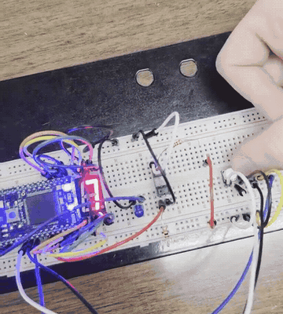

# Hardware demo! (takes a few seconds to load the demo)

**Optical-sensor-triggered countdown (Lab 3, Q1)** - pushbuttons set the countdown value; the optical sensor triggers the sequence on a seven-segment display.

(demo GIF will load here in a moment!)

[](labs/lab-03-opto-sensor/demos/q1.mp4)

*[Watch the full Lab 3 Q1 demo](labs/lab-03-opto-sensor/demos/q1.mp4) or please explore the other recordings below.*

# Embedded Systems Labs

A collection of individual embedded systems lab exercises developed in **C++ using Mbed OS 6.17.0**! These labs explore microcontroller input/output through LEDs, a seven-segment display, switches, an optical sensor, and a PWM-controlled buzzer.

Each exercise is an independent program for its associated hardware setup. Source code and short recordings of the working circuits are included below.

## Labs

### Lab 1 - Blinky LEDs

**Concepts:** GPIO output, binary representation, timing, bitwise operations.

- **[Q1 - Binary counter](labs/lab-01-leds/q1.cpp):** Cycle through values 0-7 in binary using three LEDs. [Watch demo](labs/lab-01-leds/demos/q1.mp4).
- **[Q2 - Binary addition](labs/lab-01-leds/q2.cpp):** Display operands from 0-3 and their binary sums using four LEDs, with an LED blink pattern separating values. [Watch demo](labs/lab-01-leds/demos/q2.mp4).

### Lab 2 - Seven-Segment Display

**Concepts:** Segment control, DIP-switch input, LED timing.

- **[Q1 - Number and character display](labs/lab-02-seven-segment/q1.cpp):** Show a start message, cycle through digits, and display an end message; DIP switches select displayed values. [Watch demo](labs/lab-02-seven-segment/demos/q1.mp4).
- **[Q2 - Switch-controlled blink rates](labs/lab-02-seven-segment/q2.cpp):** Select a blink-rate level using a DIP switch, show the selection on the seven-segment display, and drive LEDs at different rates. [Watch demo](labs/lab-02-seven-segment/demos/q2.mp4).

### Lab 3 - Optical Sensor

**Concepts:** Digital sensing, pushbuttons, state tracking, event counting.

- **[Q1 - Sensor-triggered countdown](labs/lab-03-opto-sensor/q1.cpp):** Use pushbuttons to set a binary countdown value from 0-7, then start the seven-segment countdown when the optical sensor is activated. [Watch demo](labs/lab-03-opto-sensor/demos/q1.mp4).
- **[Q2 - Event counter](labs/lab-03-opto-sensor/q2.cpp):** Count optical-sensor activations, show the count modulo 10 on a seven-segment display, and flash an LED for feedback. [Watch demo](labs/lab-03-opto-sensor/demos/q2.mp4).

### Lab 4 - Buzzer

**Concepts:** Pulse-width modulation (PWM), audio frequency, analog input.

- **[Q1 - Sensor-triggered melody](labs/lab-04-buzzer/q1.cpp):** Play a series of notes on a PWM-driven buzzer when the optical sensor is triggered, with visual LED feedback. [Watch demo (with sound)](labs/lab-04-buzzer/demos/q1.mp4).
- **[Q2 - Potentiometer-controlled pitch](labs/lab-04-buzzer/q2.cpp):** Read a potentiometer and map its position to a buzzer frequency of approximately 100-1,000 Hz. [Watch demo (with sound)](labs/lab-04-buzzer/demos/q2.mp4).

## Repository layout

```text
embedded-systems-labs/
├── README.md
├── LICENSE
├── assets/
│   └── opto-sensor-preview.gif
└── labs/
    ├── lab-01-leds/
    │   ├── q1.cpp
    │   ├── q2.cpp
    │   └── demos/
    │       ├── q1.mp4
    │       └── q2.mp4
    ├── lab-02-seven-segment/
    │   ├── q1.cpp
    │   ├── q2.cpp
    │   └── demos/
    │       ├── q1.mp4
    │       └── q2.mp4
    ├── lab-03-opto-sensor/
    │   ├── q1.cpp
    │   ├── q2.cpp
    │   └── demos/
    │       ├── q1.mp4
    │       └── q2.mp4
    └── lab-04-buzzer/
        ├── q1.cpp
        ├── q2.cpp
        └── demos/
            ├── q1.mp4
            └── q2.mp4
```

## Running the programs

These examples use the **Mbed API** and depend on the original lab circuits and pin assignments. Each `q1.cpp` or `q2.cpp` contains its own `main()` function, so **compile and flash each exercise separately**, rather than building the entire repository as a single application.

To run an exercise, create a compatible Mbed OS 6.17.0 project for your board, use the selected question's source as the application entry point, and connect peripherals to the pins referenced in that file. The hardware connections differ between exercises.

## Video notes

- Labs 1-3 are silent; **Lab 4 retains audio** so the buzzer output can be heard, but it's unforunately pretty quiet.
- The animated GIF above is a brief preview; the corresponding MP4 shows the complete edited demonstration :)
